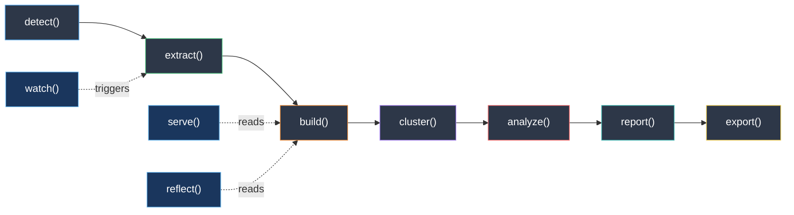
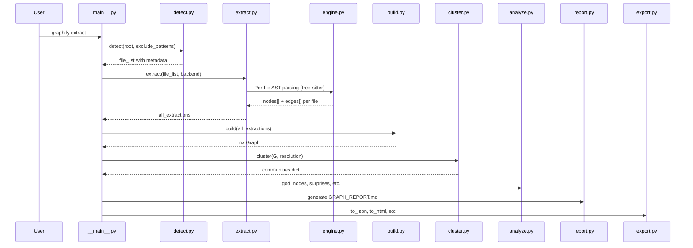
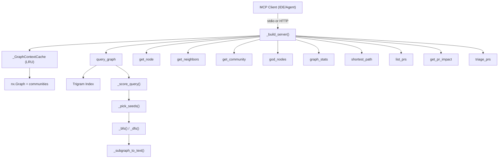
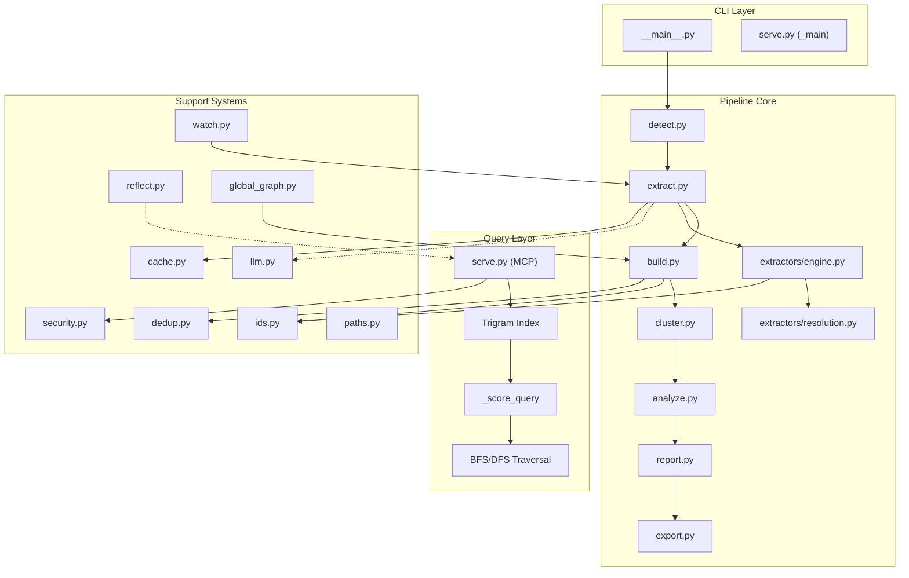
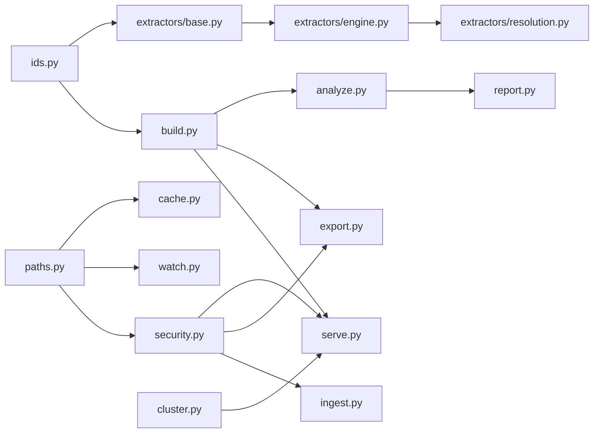
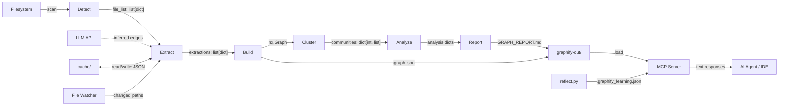
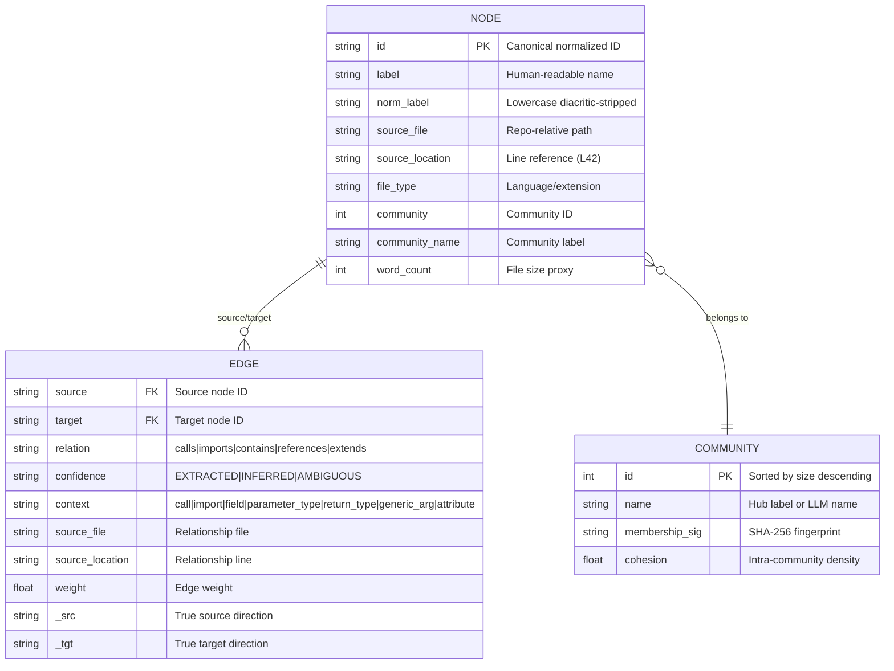
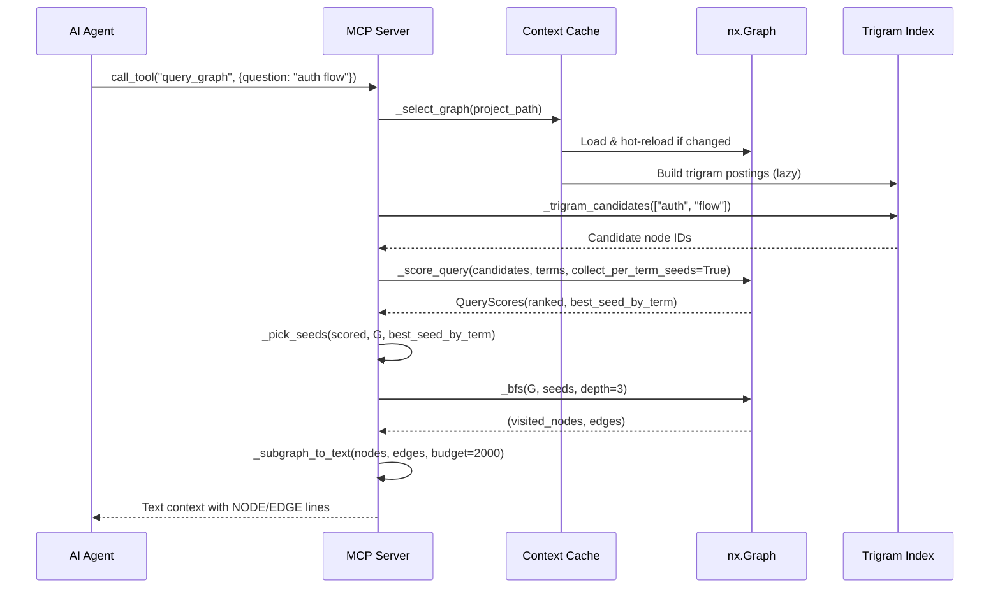

# Graphify v8 — Complete Reverse-Engineering Report

> **Analysis Mode**: READ-ONLY — no files modified, no packages installed, no git operations performed.
> **Repository**: `D:\RESILIENT_INTELLIGENCE\graphify`
> **Package**: `graphifyy` v8.x (PyPI name)
> **License**: MIT

---

## Table of Contents

1. [Phase 1 — Repository Inventory](#phase-1--repository-inventory)
2. [Phase 2 — Architectural Blueprint](#phase-2--architectural-blueprint)
3. [Phase 3 — Execution Flow](#phase-3--execution-flow)
4. [Phase 4 — Data Model](#phase-4--data-model)
5. [Phase 5 — Extraction Pipeline](#phase-5--extraction-pipeline)
6. [Phase 6 — ID Normalization System](#phase-6--id-normalization-system)
7. [Phase 7 — MCP Server & Query System](#phase-7--mcp-server--query-system)
8. [Phase 8 — Clustering & Community Detection](#phase-8--clustering--community-detection)
9. [Phase 9 — Entity Deduplication](#phase-9--entity-deduplication)
10. [Phase 10 — Export System](#phase-10--export-system)
11. [Phase 11 — Security Model](#phase-11--security-model)
12. [Phase 12 — Watch / Incremental Rebuild](#phase-12--watch--incremental-rebuild)
13. [Phase 13 — Reflection & Work Memory](#phase-13--reflection--work-memory)
14. [Phase 14 — Dependency & Technology Map](#phase-14--dependency--technology-map)
15. [Phase 15 — Reuse / Modify / Rebuild Assessment](#phase-15--reuse--modify--rebuild-assessment)

---

## Phase 1 — Repository Inventory

### Top-Level Structure

| Path | Type | Description |
|------|------|-------------|
| [`pyproject.toml`](file:///d:/RESILIENT_INTELLIGENCE/graphify/pyproject.toml) | Config | Build system, dependencies, entry points |
| [`Dockerfile`](file:///d:/RESILIENT_INTELLIGENCE/graphify/Dockerfile) | Deploy | Containerized MCP HTTP server |
| [`ARCHITECTURE.md`](file:///d:/RESILIENT_INTELLIGENCE/graphify/ARCHITECTURE.md) | Doc | Official pipeline documentation |
| [`AGENTS.md`](file:///d:/RESILIENT_INTELLIGENCE/graphify/AGENTS.md) | Doc | Claude Code integration rules |
| [`SECURITY.md`](file:///d:/RESILIENT_INTELLIGENCE/graphify/SECURITY.md) | Doc | Threat model & security controls |
| [`BENCHMARKS.md`](file:///d:/RESILIENT_INTELLIGENCE/graphify/BENCHMARKS.md) | Doc | Performance metrics |
| `graphify/` | Package | Core source (~45 modules) |
| `graphify/extractors/` | Subpkg | 31 language-specific AST extractors |
| `graphify/exporters/` | Subpkg | HTML, GraphDB (Neo4j/FalkorDB) exporters |
| `tests/` | Tests | 220 test files + fixtures |
| `tools/` | Scripts | Benchmarking & maintenance utilities |
| `scripts/` | Scripts | Installation & hook scripts |
| `docs/` | Docs | Additional documentation |
| `always_on/` | Config | Always-on configurations |
| `skills/` | Skills | Agent skill definitions |

### Core Modules by Size (lines of code)

| Module | Lines | Role |
|--------|-------|------|
| [`engine.py`](file:///d:/RESILIENT_INTELLIGENCE/graphify/graphify/extractors/engine.py) | 5,881 | Main AST extraction engine |
| [`llm.py`](file:///d:/RESILIENT_INTELLIGENCE/graphify/graphify/llm.py) | 3,407 | LLM backend abstraction (Claude, Gemini, OpenAI, Kimi, Ollama) |
| [`serve.py`](file:///d:/RESILIENT_INTELLIGENCE/graphify/graphify/serve.py) | 2,382 | MCP server (stdio + HTTP transports) |
| [`watch.py`](file:///d:/RESILIENT_INTELLIGENCE/graphify/graphify/watch.py) | 2,042 | File watcher & incremental rebuild |
| [`cache.py`](file:///d:/RESILIENT_INTELLIGENCE/graphify/graphify/cache.py) | 1,562 | Per-file extraction cache |
| [`export.py`](file:///d:/RESILIENT_INTELLIGENCE/graphify/graphify/export.py) | 1,273 | Multi-format export (HTML, JSON, SVG, GraphML, Obsidian, Cypher) |
| [`detect.py`](file:///d:/RESILIENT_INTELLIGENCE/graphify/graphify/detect.py) | ~1,200 | File discovery & classification |
| [`dedup.py`](file:///d:/RESILIENT_INTELLIGENCE/graphify/graphify/dedup.py) | 980 | Entity deduplication (MinHash/LSH + Jaro-Winkler) |
| [`reflect.py`](file:///d:/RESILIENT_INTELLIGENCE/graphify/graphify/reflect.py) | 883 | Work-memory reflection system |
| [`build.py`](file:///d:/RESILIENT_INTELLIGENCE/graphify/graphify/build.py) | ~900 | NetworkX graph assembly |
| [`analyze.py`](file:///d:/RESILIENT_INTELLIGENCE/graphify/graphify/analyze.py) | 750 | Graph analysis (god nodes, surprises, questions) |
| [`ids.py`](file:///d:/RESILIENT_INTELLIGENCE/graphify/graphify/ids.py) | ~300 | ID normalization fixpoint engine |
| [`resolution.py`](file:///d:/RESILIENT_INTELLIGENCE/graphify/graphify/extractors/resolution.py) | ~3,600 | Cross-file import/call resolution |

### Supported Languages (31 extractors)

```
Python, JavaScript/TypeScript (JSX/TSX/Vue/Svelte/Astro), Go, Rust,
Java, Kotlin, Scala, C#, C/C++, Objective-C, Swift, Ruby, PHP,
Dart, Elixir, OCaml, Julia, Pascal/Delphi, Fortran, Bash/PowerShell,
SQL, Terraform, Zig, Verilog, Common Lisp, DM (BYOND), Apex (Salesforce),
Blade (Laravel), Razor (ASP.NET), JSON/Config, Markdown
```

---

## Phase 2 — Architectural Blueprint

### Pipeline Architecture



### Module Responsibility Map

| Module | Responsibility | Input | Output | State |
|--------|---------------|-------|--------|-------|
| `detect` | Filesystem scan, file classification | Directory path, `.gitignore` | `list[dict]` of file records | None |
| `extract` | AST parsing + optional semantic extraction | File list from detect | `list[dict]` (nodes/edges per file) | Per-file cache |
| `build` | Graph assembly, dedup, edge merging | Extraction dicts | `nx.Graph` | None |
| `cluster` | Community detection (Leiden/Louvain) | `nx.Graph` | `dict[int, list[str]]` | None |
| `analyze` | God nodes, surprises, questions | Graph + communities | Analysis dicts | None |
| `report` | Markdown report generation | Graph + analysis | `GRAPH_REPORT.md` | None |
| `export` | Multi-format persistence | Graph + communities | Files on disk | None |
| `serve` | MCP server (query tools) | `graph.json` | MCP tool responses | `_GraphContextCache` (LRU) |
| `watch` | File-change detection & incremental rebuild | Filesystem events | Triggers `extract→build` | `.pending_changes` |
| `cache` | Extraction result caching | File hash + version | Cached JSON | `graphify-out/cache/` |
| `ids` | Canonical ID normalization | Raw identifier strings | Normalized ID strings | None (pure function) |
| `dedup` | Entity deduplication | Graph nodes | Merge operations | None |
| `reflect` | Work-memory lesson aggregation | `memory/` directory | `LESSONS.md` + sidecar JSON | None |
| `security` | Input validation, SSRF prevention | URLs, paths, labels | Validated/sanitized values | None |
| `llm` | LLM API abstraction | File content + prompts | Extracted relationships | Token cost tracking |

### Key Architecture Principle: Zero Shared Mutable State

Stages communicate exclusively via:
- **Python dicts** (extraction output)
- **NetworkX graphs** (build output)
- **JSON files** (persistence layer)

No global mutable state crosses stage boundaries. This is **deliberate** — the architecture doc explicitly prohibits it.

---

## Phase 3 — Execution Flow

### Entry Points

| Entry Point | Module | Purpose |
|-------------|--------|---------|
| `graphify` CLI | [`__main__.py`](file:///d:/RESILIENT_INTELLIGENCE/graphify/graphify/__main__.py) | Primary user interface |
| `graphify-serve` | [`serve.py`](file:///d:/RESILIENT_INTELLIGENCE/graphify/graphify/serve.py) | MCP server (standalone) |

### CLI Command Flow (`graphify extract .`)



### Lazy Import System

[`__init__.py`](file:///d:/RESILIENT_INTELLIGENCE/graphify/graphify/__init__.py) implements a `__getattr__`-based lazy loader — modules are only imported when first accessed, keeping `import graphify` near-instant.

---

## Phase 4 — Data Model

### Node Schema

Every node in the graph carries these attributes:

| Attribute | Type | Source | Description |
|-----------|------|--------|-------------|
| `id` | `str` | ID system | Canonical, normalized identifier |
| `label` | `str` | Extractor | Human-readable display name |
| `norm_label` | `str` | Build | Diacritic-stripped lowercase label |
| `source_file` | `str` | Extractor | Repo-relative file path |
| `source_location` | `str` | Extractor | Line reference (e.g., `L42`) |
| `file_type` | `str` | Detect | File extension / language |
| `community` | `int` | Cluster | Community ID |
| `community_name` | `str` | Export | Human label for community |
| `word_count` | `int` | Detect | File size proxy |

### Edge Schema

| Attribute | Type | Description |
|-----------|------|-------------|
| `source` | `str` | Source node ID |
| `target` | `str` | Target node ID |
| `relation` | `str` | Relationship type (`calls`, `imports`, `contains`, `references`, `extends`, etc.) |
| `confidence` | `str` | `EXTRACTED` (AST-proven), `INFERRED` (LLM-derived), `AMBIGUOUS` |
| `context` | `str` | Edge context: `call`, `import`, `field`, `parameter_type`, `return_type`, `generic_arg`, `attribute` |
| `source_file` | `str` | File where the relationship was found |
| `source_location` | `str` | Line of the relationship site |
| `weight` | `float` | Edge weight (default 1.0) |
| `_src` / `_tgt` | `str` | True direction markers (for canonicalized arc storage) |

### Confidence Taxonomy

| Level | Source | Meaning |
|-------|--------|---------|
| `EXTRACTED` | AST/tree-sitter | Deterministic, provably correct from syntax tree |
| `INFERRED` | LLM backend | Semantic relationship suggested by language model |
| `AMBIGUOUS` | Resolution | Multiple resolution targets — best guess |

### Persistence Format

- **Primary**: `graphify-out/graph.json` — NetworkX node-link JSON
- **Cache**: `graphify-out/cache/ast/v{version}-s{schema}/` and `cache/semantic/p{fingerprint}/`
- **Labels**: `.graphify_labels.json` — community name overrides
- **Analysis**: `.graphify_analysis.json` — precomputed analysis
- **Learning**: `.graphify_learning.json` — work-memory sidecar
- **Report**: `GRAPH_REPORT.md` — human-readable audit trail

---

## Phase 5 — Extraction Pipeline

### AST Extraction (Deterministic, LLM-Free)

The engine uses **tree-sitter** grammars to parse source files into ASTs and extract:

1. **File-level nodes** — one node per source file
2. **Symbol nodes** — functions, classes, methods, types, variables
3. **Structural edges** — `contains` (file→symbol), `calls` (function→function), `imports` (file→module)
4. **Type reference edges** — `parameter_type`, `return_type`, `field`, `generic_arg`, `attribute`

### Cross-File Resolution ([`resolution.py`](file:///d:/RESILIENT_INTELLIGENCE/graphify/graphify/extractors/resolution.py))

The resolution engine handles:
- **JavaScript/TypeScript**: `import`/`require`/`export` resolution with path aliases (`tsconfig.json`, `jsconfig.json`), barrel files (`index.ts`), and dynamic imports
- **Python**: Module imports with `__init__.py`, relative imports, `src/` layout detection
- **Go**: Package-qualified resolution
- **C#**: Namespace-based resolution with partial classes
- **Ruby**: `require`/`require_relative` resolution
- **Swift**: Module-level cross-file calls
- **Java/Kotlin**: Package + class hierarchy resolution

### Semantic Extraction (LLM-Powered, Optional)

When `--backend` is specified (claude, gemini, openai, kimi, ollama), the LLM receives file content wrapped in `<untrusted_source>` delimiters and produces additional inferred relationships. These are:
- Marked `INFERRED` confidence
- Independently cached by prompt fingerprint
- Never mixed with AST results in the same cache namespace

### Supported LLM Backends ([`llm.py`](file:///d:/RESILIENT_INTELLIGENCE/graphify/graphify/llm.py))

| Backend | Provider | Default Model | Vision | Pricing |
|---------|----------|---------------|--------|---------|
| `claude` | Anthropic | claude-sonnet-4-6 | ✅ | $3/$15 per 1M tokens |
| `kimi` | Moonshot | kimi-k2.6 | ✅ | — |
| `gemini` | Google | gemini-2.5-flash | ✅ | — |
| `openai` | OpenAI | gpt-4o-mini | ✅ | — |
| `ollama` | Local | configurable | — | Free |

### Extraction Caching

- **AST cache**: Keyed by `(file_content_hash, extractor_version, schema_version)`. Versioned — stale entries from old graphify versions are swept on first use.
- **Semantic cache**: Keyed by `(file_content_hash, prompt_fingerprint)`. NOT version-keyed (LLM output depends on the prompt, not the tool version). Invalidated only when the extraction prompt changes.

---

## Phase 6 — ID Normalization System

### The Fixpoint Engine ([`ids.py`](file:///d:/RESILIENT_INTELLIGENCE/graphify/graphify/ids.py))

The ID system is the **single most critical invariant** in the codebase. It ensures that the same logical entity always gets the same node ID regardless of:
- Operating system (Windows vs. POSIX path separators)
- Unicode normalization form (NFC vs. NFKD)
- Case sensitivity differences
- Punctuation variations

### Normalization Rules

```python
def normalize_id(raw: str) -> str:
    # 1. NFKD Unicode normalization
    # 2. Lowercase
    # 3. Replace path separators (/ and \) with _
    # 4. Collapse non-alphanumeric runs to single _
    # 5. Strip leading/trailing _
    # 6. FIXPOINT LOOP: repeat until stable
```

### Why Fixpoint?

A single normalization pass is insufficient because:
- Step 3 can introduce new `_` adjacent to existing `_` from step 4
- NFKD decomposition can expose new non-alphanumeric characters

The loop runs until `id == normalize(id)` — typically 1-2 iterations, capped at 10 as a safety limit.

### `make_id(*parts)` — Canonical ID Construction

All node IDs are constructed via `make_id(file_stem, symbol_name, ...)` which:
1. Joins parts with `_`
2. Runs `normalize_id` on the result
3. Returns the fixpoint-stable canonical ID

---

## Phase 7 — MCP Server & Query System

### Architecture



### MCP Tools (10 total)

| Tool | Description | Key Parameters |
|------|-------------|----------------|
| `query_graph` | BFS/DFS traversal from scored seed nodes | `question`, `mode`, `depth`, `token_budget`, `context_filter` |
| `get_node` | Full details for a specific node | `label` |
| `get_neighbors` | Direct neighbors with edge details | `label`, `relation_filter`, `token_budget` |
| `get_community` | All nodes in a community | `community_id`, `token_budget` |
| `god_nodes` | Most-connected nodes | `top_n` |
| `graph_stats` | Summary statistics | — |
| `shortest_path` | Dijkstra between two nodes | `source`, `target`, `max_hops`, `undirected` |
| `list_prs` | Open GitHub PRs with graph impact | `base`, `repo` |
| `get_pr_impact` | Detailed PR blast radius | `pr_number`, `repo` |
| `triage_prs` | Actionable PR prioritization | `base`, `repo` |

All tools accept an optional `project_path` for multi-project servers.

### MCP Resources (6 total)

| URI | Description |
|-----|-------------|
| `graphify://report` | Full `GRAPH_REPORT.md` |
| `graphify://stats` | Node/edge/community counts |
| `graphify://god-nodes` | Top 10 most-connected nodes |
| `graphify://surprises` | Cross-community surprising connections |
| `graphify://audit` | Confidence breakdown |
| `graphify://questions` | Suggested questions |

### Query Scoring Algorithm

The scoring system in `_score_query()` uses a **multi-tier, IDF-weighted** ranking:

1. **Full-query tier** (10x exact/prefix bonus, weighted by rarest constituent term IDF)
2. **Per-term tiers** (exact > prefix > substring), scaled by squared coverage fraction
3. **Source-file bonus** (flat, unscaled by coverage)
4. **IDF weighting** per term based on document frequency in graph labels
5. **Trigram prefilter** — candidate generation via character trigram postings index
6. **Per-term seed guarantee** — ensures at least one BFS seed per distinct query term

### Trigram Index

Built lazily on graph load and cached in `_GraphContextCache`:
- Postings list: trigram → sorted list of node indices
- Set cache: avoids repeated `set()` conversions during intersection
- Guard fraction: falls back to full scan when rarest trigram is too common

### Transports

| Transport | Class | Security |
|-----------|-------|----------|
| **stdio** | `serve()` | Per-process, stdin/stdout pipes |
| **Streamable HTTP** | `serve_http()` | API key (`X-API-Key` or `Authorization: Bearer`), DNS rebinding protection, session timeout |

### MCP Version Compatibility

The server dynamically detects mcp 1.x vs 2.x:
- **1.x**: Decorator-based (`@server.list_tools()`)
- **2.x**: Constructor callbacks (`on_list_tools=...`)

---

## Phase 8 — Clustering & Community Detection

### Algorithm ([`cluster.py`](file:///d:/RESILIENT_INTELLIGENCE/graphify/graphify/cluster.py))

1. **Primary**: Leiden via `graspologic` (best quality, deterministic with `random_seed=42`)
2. **Fallback**: Louvain via `networkx` (built-in, `seed=42`)
3. **Deterministic ordering**: Nodes and edges sorted before partitioning for run-to-run stability
4. **Hub exclusion**: Optional `exclude_hubs_percentile` removes super-hubs before partitioning, then reattaches via majority-vote
5. **Oversized community splitting**: Communities >25% of graph (min 10 nodes) get a second Leiden pass
6. **Low-cohesion splitting**: Communities with cohesion <0.05 and ≥50 nodes get re-split
7. **Stable re-indexing**: Communities sorted by `(-size, tuple(sorted(members)))` — total order, deterministic IDs

### Community Labeling

- **Default**: Hub-based labeling — highest-degree member becomes the label (`label_communities_by_hub`)
- **Optional**: LLM-generated names (when configured, override hub labels)
- **Persistence**: `.graphify_labels.json` with SHA-256 membership fingerprints for staleness detection

### Community ID Remapping

`remap_communities_to_previous()` matches new communities to previous ones by intersection size (greedy bipartite matching), minimizing "community churn" in diffs.

---

## Phase 9 — Entity Deduplication

### Pipeline ([`dedup.py`](file:///d:/RESILIENT_INTELLIGENCE/graphify/graphify/dedup.py))

```
Exact normalization → Entropy gate → MinHash/LSH blocking →
Jaro-Winkler verification → Same-community boost → Union-find merge
```

### Key Components

| Step | Purpose | Details |
|------|---------|---------|
| Normalization | Case-fold + collapse non-alnum | NFKC + casefold + regex |
| Entropy gate | Skip low-information labels | Shannon entropy in bits/char |
| MinHash/LSH | Candidate pair generation | 128 permutations, character 3-grams (spaces stripped) |
| Jaro-Winkler | Verification scoring | Via `rapidfuzz` library |
| Variant blocking | Prevent false merges | Short labels with version/SKU suffixes blocked |
| Same-community boost | Prefer intra-community merges | Boost score for nodes in same community |
| Union-find | Merge execution | Standard union-find with edge rewiring |

### Custom MinHash (`_minhash.py`)

The project ships its own MinHash and MinHashLSH implementation (not `datasketch`) for:
- Deterministic hashing
- Space efficiency
- Avoiding the heavy `datasketch` dependency

---

## Phase 10 — Export System

### Output Formats ([`export.py`](file:///d:/RESILIENT_INTELLIGENCE/graphify/graphify/export.py))

| Format | Function | Description |
|--------|----------|-------------|
| JSON | `to_json()` | NetworkX node-link format (`graph.json`) |
| HTML | `to_html()` | Interactive D3.js force-directed visualization |
| SVG | (via HTML) | Static graph rendering |
| GraphML | `to_graphml()` | Standard graph interchange format |
| Obsidian | `to_obsidian()` | Vault of interconnected markdown notes |
| Neo4j Cypher | `push_to_neo4j()` | Cypher CREATE statements |
| FalkorDB | `push_to_falkordb()` | Graph database push |
| Wiki | `to_wiki()` | Markdown wiki with community pages |

### Backup System

Before overwriting, `backup_if_protected()` snapshots artifacts to a dated subfolder when:
- `.graphify_semantic_marker` exists (graph cost real LLM tokens), OR
- `.graphify_labels.json` contains non-default community labels (human/LLM curated)

Backup artifacts: `graph.json`, `GRAPH_REPORT.md`, `.graphify_labels.json`, `.graphify_analysis.json`, `manifest.json`, `.graphify_semantic_marker`, `cost.json`

---

## Phase 11 — Security Model

### Threat Model (from [`SECURITY.md`](file:///d:/RESILIENT_INTELLIGENCE/graphify/SECURITY.md))

| Threat | Control | Module |
|--------|---------|--------|
| **SSRF via URL fetch** | IP blocking (private/reserved/link-local/CGN/NAT64), scheme allowlist, DNS pre-resolution | `security.py` |
| **Path traversal** | Chroot-like validation, graphify-out containment | `security.py`, `paths.py` |
| **Prompt injection** | `sanitize_label()` strips ANSI escapes, HTML entities, control characters from all LLM-derived fields (F-010) | `security.py` |
| **Graph file bomb** | 512 MiB default cap (`GRAPHIFY_MAX_GRAPH_BYTES` override) | `security.py` |
| **Label injection** | `sanitize_metadata()` for all metadata fields; `<untrusted_source>` delimiters for LLM input | `security.py`, `llm.py` |
| **Arbitrary code execution** | No `eval()`, no `shell=True`, no `pickle` | Codebase-wide |
| **DNS rebinding** | Host header validation for HTTP transport; allowlist when binding specific address | `serve.py` |
| **API key timing attack** | `hmac.compare_digest()` for constant-time comparison | `serve.py` |

### Input Sanitization Chain

```
User input → validate_url() → safe_fetch() → sanitize_label() → MCP output
Corpus files → <untrusted_source sha256=...> → LLM → sanitize_metadata() → graph
```

---

## Phase 12 — Watch / Incremental Rebuild

### File Watching ([`watch.py`](file:///d:/RESILIENT_INTELLIGENCE/graphify/graphify/watch.py))

1. **Filesystem monitoring**: Detects file changes (create/modify/delete)
2. **Pending queue**: `.pending_changes` file — append-mode writes for concurrent safety
3. **Drain cycle**: Lock-holding process drains pending queue before and after rebuild
4. **Build config persistence**: `.graphify_build.json` preserves `--exclude` patterns across rebuilds
5. **Incremental extract**: Only re-extracts changed files, merges with cached results
6. **Hook integration**: Post-commit hooks trigger incremental updates

### Incremental Update Flow

```
File change detected → queue to .pending_changes → acquire rebuild lock →
drain pending → detect(changed_only=True) → extract(delta) →
merge with existing graph → re-cluster → re-export → release lock
```

---

## Phase 13 — Reflection & Work Memory

### System ([`reflect.py`](file:///d:/RESILIENT_INTELLIGENCE/graphify/graphify/reflect.py))

The reflection system implements a **deterministic, LLM-free** experiential learning layer:

1. **Memory docs**: Q&A results saved by `graphify save-result` in `graphify-out/memory/`
2. **Outcome signals**: `useful`, `dead_end`, `corrected`
3. **Scoring**: Signed, time-decayed scores (half-life = 30 days by default)
4. **Corroboration**: A node needs ≥2 distinct `useful` results to become "preferred"

### Lesson Categories

| Category | Criteria | Purpose |
|----------|----------|---------|
| Preferred sources | ≥2 corroborated useful results | Trust these nodes first |
| Tentative | 1 useful result | Not yet corroborated |
| Contested | Mixed positive + negative signals | Recency decides |
| Known dead ends | Marked `dead_end` | Don't re-derive |
| Corrections | User-corrected answers | Override LLM output |

### Learning Sidecar

`.graphify_learning.json` — a separate file from `graph.json` (never pollutes the structural truth). Read at display time and overlaid onto MCP tool output as `learning=preferred` or `learning=preferred:stale` annotations.

---

## Phase 14 — Dependency & Technology Map

### Core Dependencies

| Dependency | Version Constraint | Purpose | Criticality |
|------------|-------------------|---------|-------------|
| `networkx` | ≥3.0 | Graph data structure | **Critical** — entire data model |
| `tree-sitter` | ≥0.20 | AST parsing | **Critical** — all extraction |
| `tree-sitter-languages` | Various | Language grammars | **Critical** — per-language support |
| `rapidfuzz` | Any | Jaro-Winkler distance | Dedup verification |
| `click` | Any | CLI framework | User interface |
| `chardet` | Any | Character encoding detection | File reading |
| `tiktoken` | Optional | Token counting | Cost estimation |

### Optional Dependencies (extras)

| Extra | Packages | Purpose |
|-------|----------|---------|
| `[mcp]` | `mcp`, `starlette`, `uvicorn` | MCP server (stdio + HTTP) |
| `[neo4j]` | `neo4j` | Neo4j graph database export |
| `[falkordb]` | `falkordb` | FalkorDB graph database export |
| `[llm]` | `anthropic`, `openai`, `google-generativeai` | LLM backends |
| `[leiden]` | `graspologic` | Leiden community detection |
| `[vision]` | Various | Image/diagram extraction |

### Technology Stack

| Layer | Technology |
|-------|-----------|
| Language | Python 3.12+ |
| Graph engine | NetworkX |
| AST parsing | tree-sitter |
| Clustering | graspologic (Leiden) / networkx (Louvain) |
| Fuzzy matching | rapidfuzz |
| MCP protocol | mcp SDK (1.x and 2.x compatible) |
| HTTP server | Starlette + Uvicorn |
| Container | Docker (python:3.12-slim) |
| Serialization | JSON (stdlib) |
| Hashing | SHA-256 (content), SHA-1 (namespace IDs) |

---

## Phase 15 — Reuse / Modify / Rebuild Assessment

### Reuse / Modify / Rebuild Map

This assessment evaluates each component for use in a future "RESILIENT INTELLIGENCE" system.

#### 🟢 REUSE AS-IS (Domain-agnostic, high quality)

| Component | Rationale |
|-----------|-----------|
| **ID Normalization** (`ids.py`) | Pure functions, zero dependencies beyond stdlib. Fixpoint algorithm is domain-agnostic. |
| **Security** (`security.py`) | URL validation, SSRF prevention, label sanitization — all reusable. |
| **Clustering** (`cluster.py`) | Wraps standard algorithms with smart oversized-community splitting and deterministic ordering. |
| **Dedup Pipeline** (`dedup.py`) | MinHash/LSH + Jaro-Winkler is a standard NLP pipeline, fully domain-agnostic. |
| **Atomic Writes** (`paths.py`) | `_atomic_replace()` is a robust, cross-platform atomic file write. |
| **MCP Server Framework** (`serve.py` — transport layer) | The HTTP/stdio transport wiring, API key middleware, session management, DNS rebinding protection. |
| **Cache System** (`cache.py` — framework) | Content-hash-based caching with version invalidation is reusable for any extraction pipeline. |

#### 🟡 MODIFY (Software-specific but pattern is generalizable)

| Component | What to Keep | What to Change |
|-----------|-------------|----------------|
| **Detection** (`detect.py`) | File scanning, `.gitignore` parsing, classification framework | Replace language-specific classification with domain-specific classification |
| **Extraction Framework** (`extract.py`, `engine.py`) | Plugin architecture, per-file dispatch, cache integration | Replace tree-sitter grammars with domain-specific parsers |
| **Build System** (`build.py`) | Node dedup, edge merging, graph assembly pattern | Replace software-specific edge types with domain-specific ones |
| **Query Scoring** (`serve.py` — scoring) | Trigram index, IDF weighting, multi-tier scoring, seed selection | Replace software-specific heuristics (source_file matching, etc.) |
| **Analysis** (`analyze.py`) | God-node ranking, cross-community surprise detection | Replace software-specific noise filters (`_BUILTIN_NOISE_LABELS`) |
| **Report** (`report.py`) | Markdown report template and structure | Replace software-specific sections |
| **Export** (`export.py`) | Multi-format export framework | Add/remove formats as needed |
| **Watch** (`watch.py`) | Filesystem monitoring + incremental rebuild pattern | Replace file-type-specific logic |
| **Reflection** (`reflect.py`) | Experiential learning pattern, scoring, corroboration | Keep as-is — already domain-agnostic |
| **LLM Abstraction** (`llm.py`) | Multi-backend abstraction, cost tracking, token counting | Replace extraction prompts |

#### 🔴 REBUILD (Too software-specific)

| Component | Rationale |
|-----------|-----------|
| **31 Language Extractors** (`extractors/*.py`) | Entirely tree-sitter grammar-specific. Each is a deep integration with language syntax. |
| **Cross-File Resolution** (`resolution.py`) | ~3,600 lines of JS/TS/Python/Go/C#/Ruby/Swift import resolution. |
| **PR Integration** (`prs.py`) | GitHub-specific, tightly coupled to `gh` CLI. |
| **Installation/Hooks** (`install.py`, hooks) | git hook management, CLAUDE.md integration. |
| **Skill Generation** (`skillgen.py`) | Claude Code skill file generation. |

---

## Artifact 1: System Map



## Artifact 2: Dependency Map

### Internal Module Dependencies (Critical Path)



### External Dependency Graph

```mermaid
graph TD
    graphify["graphifyy"] --> networkx
    graphify --> tree_sitter["tree-sitter"]
    graphify --> rapidfuzz
    graphify --> click
    graphify --> chardet
    graphify -.-> mcp["mcp (optional)"]
    graphify -.-> starlette["starlette (optional)"]
    graphify -.-> uvicorn["uvicorn (optional)"]
    graphify -.-> graspologic["graspologic (optional)"]
    graphify -.-> anthropic["anthropic (optional)"]
    graphify -.-> openai["openai (optional)"]
    graphify -.-> tiktoken["tiktoken (optional)"]
    mcp --> starlette
```

## Artifact 3: Data-Flow Map



## Artifact 4: Graph Data Model



## Artifact 5: MCP Interaction Map



## Artifact 6: Reuse / Modify / Rebuild Summary Table

| Component | Assessment | Lines | Effort to Generalize |
|-----------|-----------|-------|---------------------|
| `ids.py` | 🟢 Reuse | ~300 | None |
| `security.py` | 🟢 Reuse | ~460 | None |
| `cluster.py` | 🟢 Reuse | ~320 | None |
| `dedup.py` | 🟢 Reuse | ~980 | None |
| `paths.py` (atomic write) | 🟢 Reuse | ~440 | None |
| `cache.py` (framework) | 🟢 Reuse | ~1,560 | Minimal — swap cache key schema |
| `reflect.py` | 🟢 Reuse | ~880 | None — already domain-agnostic |
| `serve.py` (transport) | 🟢 Reuse | ~400 | None |
| `detect.py` | 🟡 Modify | ~1,200 | Replace file classifiers |
| `build.py` | 🟡 Modify | ~900 | Replace edge types |
| `serve.py` (query/scoring) | 🟡 Modify | ~1,200 | Replace software heuristics |
| `analyze.py` | 🟡 Modify | ~750 | Replace noise filters |
| `report.py` | 🟡 Modify | ~330 | Replace section templates |
| `export.py` | 🟡 Modify | ~1,270 | Add/remove formats |
| `watch.py` | 🟡 Modify | ~2,040 | Replace file-type logic |
| `llm.py` | 🟡 Modify | ~3,400 | Replace extraction prompts |
| `extractors/*.py` (31 files) | 🔴 Rebuild | ~8,000+ | N/A — language-specific |
| `resolution.py` | 🔴 Rebuild | ~3,600 | N/A — import resolution |
| `prs.py` | 🔴 Rebuild | ~500 | N/A — GitHub-specific |
| `install.py` | 🔴 Rebuild | ~1,000+ | N/A — git hooks |

### Key Insight

> **~5,940 lines** of domain-agnostic, production-hardened code (🟢) can be lifted verbatim.<br>
> **~11,040 lines** of framework code (🟡) require targeted modifications but preserve architectural patterns.<br>
> **~13,100+ lines** of software-specific code (🔴) must be rebuilt for a new domain.

The **architecture itself** — the pipeline pattern, the ID normalization contract, the cache-before-extract strategy, the trigram-then-score query model, the sidecar-based learning layer — is the most valuable reusable asset, independent of the code.

---

> **End of Report** — All 15 phases complete. Repository preserved in its original state.
